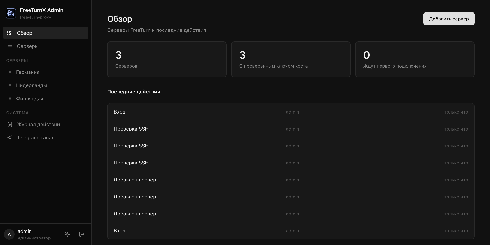
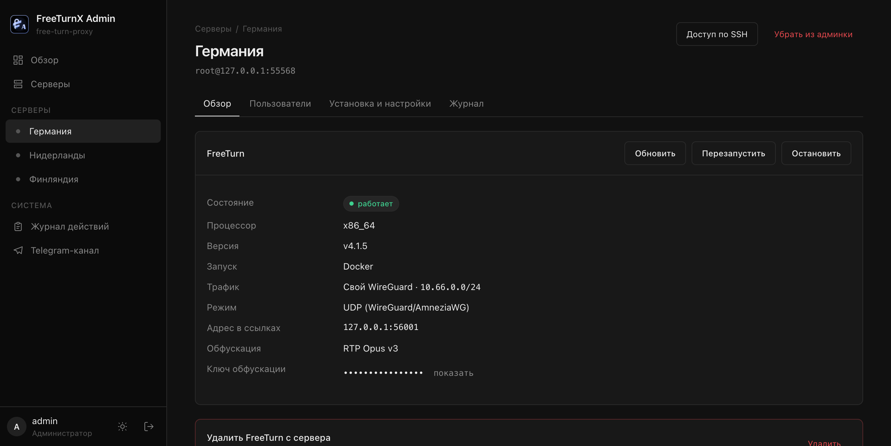
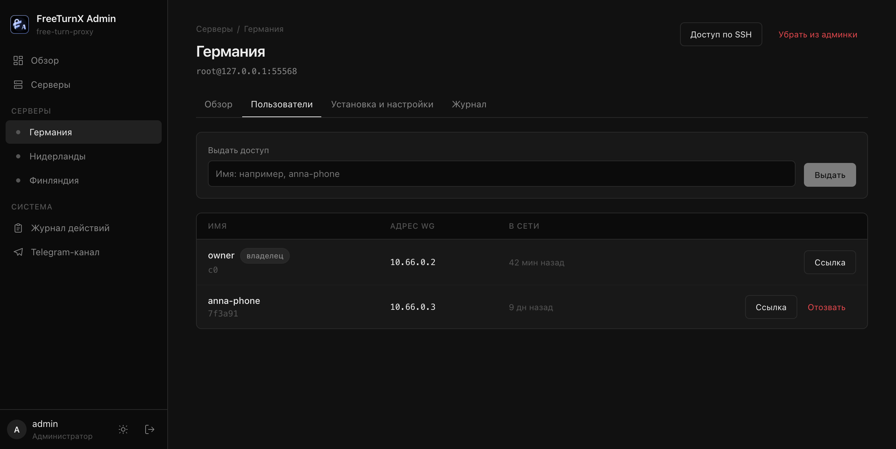
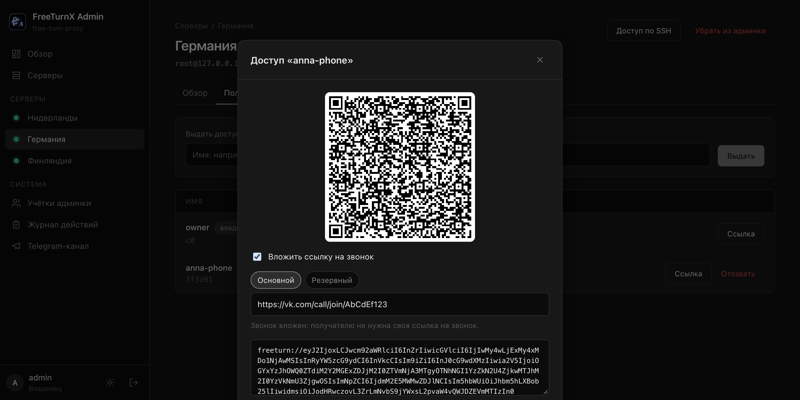
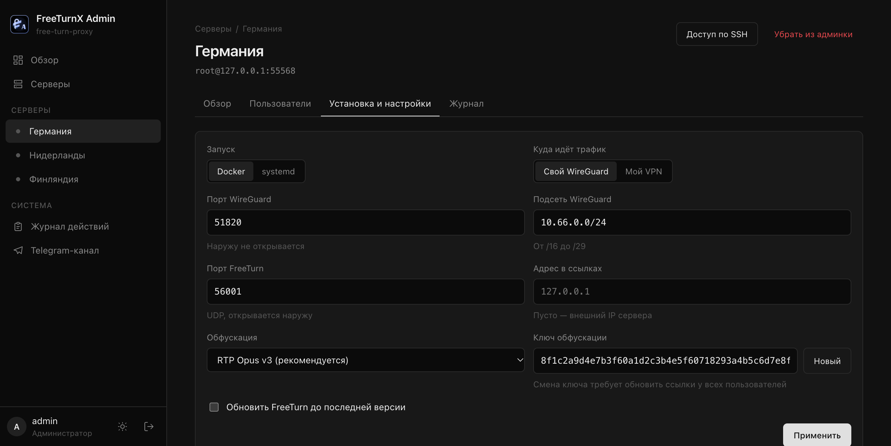
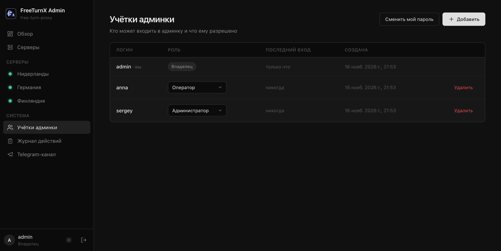

<p align="center"></p>

# FreeTurnX Admin

Веб-админка для серверов [free-turn-proxy](https://github.com/hackdiaz-dev/free-turn-proxy): подключение к VPS по SSH,
установка и перенастройка сервера, выдача и отзыв доступа пользователям.

Функции:

- вход администратора, серверы с доступом по SSH (пароль или ключ, sudo; секреты в БД зашифрованы), журнал действий;
- SSH с проверкой ключа хоста: первый запоминается, при смене операции блокируются до явного подтверждения;
- состояние сервера, установка и перенастройка FreeTurn мастером (Docker/systemd, свой WireGuard или «Мой VPN»,
  UDP/TCP, порт, обфускация с генерацией ключа, обновление), перезапуск, остановка, удаление, журнал сервера;
- пользователи сервера: список с «был в сети», выдача доступа ссылкой `freeturn://` и QR (по желанию — с вложенной
  ссылкой на звонок, как в клиентах), отзыв.
- звонки сервера: список ссылок на звонки (хранятся зашифрованными), окно доступа предлагает их одним нажатием;
- учётки админки с ролями: владелец (первый администратор), администратор (всё, включая учётки),
  оператор (серверы и их пользователи, учётки только просматривает); смена своего пароля;
- доступность серверов в списке: зелёная точка — SSH отвечает (проверка раз в 15 с, красная — после двух неудач подряд);
- тёмная и светлая тема, логотип и иконка вкладки меняются вместе с темой.

Всё это через `install.sh` ядра (RPC proto 3), как в Android-клиенте. Дальше по плану: автонастройка новых серверов,
профили протоколов клиентов, сроки и лимиты как в 3x-ui.

## Скриншоты

Тестовые данные.

| Обзор | Сервер |
|---|---|
|  |  |
| **Пользователи** | **Выдача доступа со звонком** |
|  |  |
| **Установка, настройки и звонки** | **Учётки админки** |
|  |  |

## Установка одной командой

На Linux-сервер с systemd (amd64 или arm64), без Docker:

```sh
wget -qO- https://github.com/ftx-dev/freeturn-admin/releases/latest/download/install.sh | sudo bash
```

Установщик скачивает последний релиз, сверяет контрольную сумму, ставит службу `freeturn-admin` и печатает адрес, логин и пароль первого администратора. Данные - в `/var/lib/freeturn-admin`, настройки - в `/etc/freeturn-admin/env`. Раз в сутки админка сама обновляется до последнего релиза.

Параметры - после `sudo bash -s --`: `--port 9000`, `--listen 127.0.0.1:8080 --behind-proxy` (за своим HTTPS-прокси), `--version v0.1.0`, `--no-auto-update`, `--uninstall` (данные остаются).

## Запуск в Docker

```sh
cp .env.example .env            # задайте POSTGRES_PASSWORD
docker compose up -d --build    # админка + PostgreSQL на http://127.0.0.1:8080
# или одна SQLite:
docker compose -f docker-compose.sqlite.yml up -d --build
```

Без Docker: `task build && FTA_COOKIE_SECURE=false ./build/freeturn-admin`. Разработка: `task dev`, тесты: `task test` и `task test-pg`.

Снаружи открывайте только через HTTPS-прокси (Caddy, nginx) с `FTA_TRUST_PROXY=true`. В томе `/data` лежит мастер-ключ
шифрования секретов — без него пароли и ключи SSH в БД не расшифровать, сохраняйте его вместе с резервной копией БД.

| Переменная | По умолчанию | |
|---|---|---|
| `FTA_LISTEN` | `:8080` | адрес HTTP |
| `FTA_DB_DRIVER` | `sqlite` | `sqlite` или `postgres` |
| `FTA_DB_DSN` | `file:data/freeturn-admin.db` | строка подключения |
| `FTA_DATA_DIR` | `data` | БД SQLite и мастер-ключ |
| `FTA_MASTER_KEY` / `FTA_MASTER_KEY_FILE` | создаётся в `data/master.key` | 32 байта в base64 |
| `FTA_ADMIN_LOGIN` / `FTA_ADMIN_PASSWORD` | — | первый администратор при пустой БД |
| `FTA_COOKIE_SECURE` | `true` | `false` — только для http на localhost |
| `FTA_TRUST_PROXY` | `false` | брать IP клиента из `X-Forwarded-For` |
| `FTA_TLS_CERT` / `FTA_TLS_KEY` | — | TLS без прокси |
| `FTA_CORE_VERSION` | `latest` | ветка или тег free-turn-proxy, откуда берётся `install.sh` |
| `FTA_INSTALL_SCRIPT` | — | свой `install.sh` из файла вместо GitHub |

Стек: React + Zustand + TanStack Router (фронт), Go + fasthttp (монолит), PostgreSQL или SQLite, Docker Compose.

Клиенты: [macOS](https://github.com/ftx-dev/freeturn-macos) · [Windows](https://github.com/ftx-dev/freeturn-win).
Новости - в [Telegram-канале](https://t.me/+ZVdbpZB0w_Q1MTdi).
